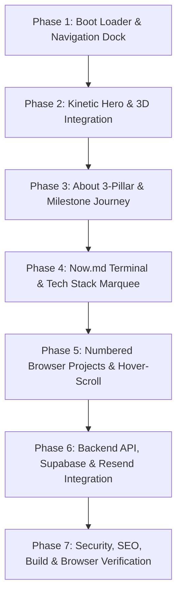

# PORTFOLIO REBUILD & ELEVATION PLAN: MUBX.DEV BENCHMARK
**Subject:** Muhammad Hamza Azam — Personal AI Engineer Portfolio  
**Target Benchmark:** [https://mubx.dev/](https://mubx.dev/)  
**Checkpoint Resumed:** 17-09-2026 Codebase State  
**Status:** PROPOSED TECHNICAL PLAN — PENDING USER APPROVAL (NO CODE MODIFIED YET)

---

## 1. Context & Architectural Baseline

### 1.1 The Checkpoint
We are continuing strictly from the **17-09-2026** codebase state:
- **Build tool:** Vite 8 ES module environment (`package.json`, `vite.config.js`).
- **3D Engine:** High-performance Three.js WebGL Neural Core (`src/3d/NeuralScene.js`).
- **Smooth Scroll & Motion:** Lenis + GSAP ScrollTrigger orchestration (`src/animations/scrollController.js`).
- **Projects Schema:** 5 verified senior AI flagship case studies in `src/config/projectsData.js`.
- **Assets:** High-resolution generated dashboard previews in `assets/projects/`.
- **Build Health:** Production build succeeds in ~1.07s with 0 errors (`npm run build`).

### 1.2 The Goal
Elevate the current portfolio to the **mubx.dev standard of product engineering, aesthetic polish, and micro-interaction excellence**, replacing all dummy or placeholder content with Muhammad Hamza Azam's authentic CV and technical achievements as an **AI Engineer & Machine Learning Systems Architect**.

---

## 2. Reference Structure vs. Target Structure

```
MUBX.DEV REFERENCE                           HAMZA AZAM AI ENGINEER TARGET
-------------------------------------        ---------------------------------------------
[Boot Loader: 0% → 100%]                      [AI Systems Initialization: 0% → 100%]
  - Tabular % counter                          - Tabular % counter + progress bar
  - Monospace status ("Initializing")          - Technical telemetry steps (Neural env, Vector store)
  - Split-panel reveal transition              - Split-panel curtain reveal transition

[Fixed Floating Pill Navbar]                 [Centered Floating Pill Navbar]
  - Logo + navigation links                    - "MHA // AI" brand + Section pills
  - Resume button + "Book a Call" CTA          - Technical CV download + "Contact / Inquire" CTA
[Left Floating Social Dock]                  [Left Floating Social Dock]
  - GitHub, LinkedIn, Instagram tooltips       - Verified GitHub, LinkedIn, Email tooltips

[Hero Section]                               [Hero Section: Kinetic Systems Architecture]
  - Branching typography: "I build..."         - Kinetic typography: "I build autonomous pipelines..."
  - Portrait photo with neon glow              - Three.js WebGL Neural Core + Telemetry overlay
  - Dual CTAs: Calendly + Download             - Dual CTAs: "Explore Flagship Systems" + "Download CV"

[About Section]                              [About Section: The Engineer Behind The Systems]
  - Top 4-metric strip                         - Top 4-metric strip (Flagship Systems, Biometrics 512-d)
  - 3 columns: Why I Code, How I Think,        - 3 columns: Why I Build, How I Think, Beyond Code
    Beyond Code                                - SMIU CS degree anchor & Saylani credentials
  - Horizontal milestone journey               - Horizontal milestone trajectory track

[Currently Building]                         [Currently Building: System Status]
  - "$ cat /now.md" terminal status card       - "$ cat /now.md" live production status card
                                               (SAP Invoice Automation, AegisX, RAG Sync)

[Tech Stack]                                 [Tech Stack: Tools of the Trade]
  - Sticky scroll-pinned categories            - 4 Numbered Domains: 01 AI/ML, 02 AI Systems,
  - Primary core tech cards + secondary pills    03 Backend/Data, 04 Automation/Tools
  - Infinite marquee ticker at bottom          - High-contrast icon cards + Infinite marquee ticker

[Featured Projects]                          [Featured Projects: Numbered Engineering Systems]
  - Numbered cards (01, 02, 03...)             - Numbered Flagship Systems (01, 02, 03, 04, 05)
  - Simulated browser frame with traffic dots  - Simulated browser frame with traffic dots & URL bar
  - Hover-scrolling mockup (6000ms duration)   - Hover-scrolling high-res dashboard mockup
  - Tech pills + Live / Code links             - Architecture deep-dive modal trigger + GitHub links
  - Supporting projects list                   - Supporting platforms 3-column grid

[Contact & Action]                           [Contact System: Production API + Database]
  - "Let's build together" headline            - "Let's build together" headline
  - Action buttons (Calendly + Email)          - Real interactive inquiry form (Name, Email, Subject, Msg)
                                               - Backend API endpoint: POST /api/contact
                                               - Database persistence: Supabase PostgreSQL
                                               - Real-time notification: Resend Email dispatch

[Footer]                                     [Footer: Terminal Status]
  - "$ omar --version 2026"                    - "$ hamza --version 2026"
  - Copyright + social links                   - Verified links: GitHub, LinkedIn, Email
```

---

## 3. Core Architectural Decision: Vite vs. Next.js App Router

A critical requirement is the **server-side Contact API (`POST /api/contact`)** connecting to **Supabase PostgreSQL** and **Resend email dispatch**, with **zero client-side credential exposure**.

### Evaluation of Options

| Dimension | Option A: Vite 8 + Vercel/Node Serverless API | Option B: In-Place Migration to Next.js 15 App Router |
| :--- | :--- | :--- |
| **Existing Codebase Impact** | **Minimal to zero**. 100% of existing HTML, CSS, Three.js (`NeuralScene.js`), Lenis/GSAP (`scrollController.js`), and component scripts remain directly active without React rewrites. | **Moderate**. Requires wrapping Vanilla Three.js and GSAP inside React `'use client'` components (`useEffect` / `useRef`). |
| **Server-Side API (`POST /api/contact`)** | Implemented cleanly via `api/contact.js` (Node/Express dev server locally via Vite plugin/proxy, and standard Vercel serverless function in production). | Implemented natively in `app/api/contact/route.js`. |
| **Environment Variables Security** | `process.env.RESEND_API_KEY` and `process.env.SUPABASE_SERVICE_ROLE_KEY` reside exclusively in serverless/Node environment; never bundled into client JS. | Identical. Server-only environment variables never reach the browser. |
| **Build & Dev Speed** | Instant (~400ms Vite HMR, 1s build). | ~1.5s Fast Refresh, 8-12s Next.js build. |
| **Direct Reference Parity** | Recreates 100% of mubx.dev visual and interaction standard using lightweight, ultra-performant Vanilla/Vite tooling. | Matches Next.js tech stack used by mubx.dev directly. |

### Architectural Recommendation
- **Recommended Path: Option A (Vite 8 + Serverless API Architecture)**:
  - Preserves the fast, clean, zero-bloat foundation built on 17-09-2026.
  - Avoids introducing heavy React hydration overhead for a portfolio that relies on pure WebGL, Lenis, and GSAP.
  - Adds a dedicated `server/api.js` (for local development) and `api/contact.js` (standard Vercel/Netlify serverless function) to handle `POST /api/contact`, Supabase PostgreSQL ingestion, and Resend email dispatch securely.
- *Note:* If the user specifically prefers a pure Next.js 15 App Router codebase, we have the complete migration blueprint ready to convert cleanly into Next.js without losing any visual quality.

---

## 4. Detailed Component & Engineering Strategy

### 4.1 Initial Boot Loader (`src/components/BootLoader.js`)
- **Visuals:** Full-screen obsidian overlay (`#07090e`) with a glowing top hairline progress indicator (`#5eead4` / cyan accent).
- **Numerals:** Large monospace tabular digits (`0%` → `100%`).
- **Telemetry Stages:**
  - `00% — INITIALIZING RUNTIME`
  - `24% — CONFIGURING THREE.JS WEBGL NEURAL ENGINE`
  - `52% — MOUNTING BIOMETRIC & VECTOR PIPELINES`
  - `78% — SYNCHRONIZING MULTI-AGENT STATE MACHINES`
  - `100% — AI SYSTEMS OPERATIONAL`
- **Transition:** On reaching `100%`, top and bottom curtain panels slide open smoothly with GSAP (`yPercent: -100` and `yPercent: 100`), revealing the hero.
- **Session Optimization:** Checks `sessionStorage.getItem('mha-booted')` so returning visits within the session transition immediately without re-playing the full sequence.

### 4.2 Hero Kinetic Systems Typography & 3D Integration
- **Kinetic Layout:**
  - Monospace eyebrow: `// MUHAMMAD HAMZA AZAM — AI SYSTEMS ARCHITECT`
  - Structured branching typographic composition inspired by mubx.dev:
    ```
          [ I ]
            |
    [ build ] --- [ ● ]
                    |
            [ autonomous ] --- [ ● ]
                                 |
                         [ production ] --- [ ● ]
                                              |
                                    [ AI systems ]
    ```
  - Subtitle: *"Specializing in Multi-Agent Workflows (LangGraph), Computer Vision (ArcFace/RetinaFace), Enterprise Multimodal Automation, and Production RAG."*
  - CTAs: Primary *"Explore Flagship Systems"* + Secondary *"Download Technical CV"* + Tertiary *"Book Consultation / Direct Inquiry"*.
- **3D WebGL Neural Scene:**
  - Integrated directly in the right hero viewport with a sleek dark glass container and subtle coordinate telemetry badge (`LAT 24.8607° N // LON 67.0011° E — KARACHI, PK`).
  - Retains the central glowing nucleus, icosahedron lattice, 5 agent nodes, Bezier spline data pipelines, and floating data packets.

### 4.3 About Section: "The Engineer Behind The Systems"
- **Top 4-Metric Grid:**
  - `5` Flagship AI Systems
  - `3` Enterprise Production Pipelines
  - `512-d` Facial Biometric Vector Embeddings
  - `100%` Deterministic Schema Enforcement
- **Headline:** `// ABOUT ME` → **"The engineer behind<br/><span class="text-accent">the systems.</span>"**
- **3 Philosophical Pillars:**
  1. `// THE WHY — Why I Build:` Turning mathematical machine learning theory into resilient production software. Moving beyond brittle zero-shot prompts to robust, observable systems.
  2. `// HOW I THINK — How I Think:` The "Zero-Silent-Failures" rule. In enterprise AI, a silent hallucination is far worse than an explicit error. Strict Pydantic schemas, confidence thresholds, and human-in-the-loop review.
  3. `// BEYOND CODE — Beyond Code:` Exploring autonomous agent coordination DAGs, benchmarking frontier multimodal models, and contributing to applied AI engineering.
- **Milestone Journey Track:**
  - Connected horizontal node stream:
    - `2022 — Academic CS & Data Analytics (SMIU & Google Analytics)`
    - `2023 — Machine Learning Research & Deep Vision (TensorFlow / ArcFace)`
    - `2024 — Agentic AI Certification & Enterprise Automation (SMIT)`
    - `2026 — Production AI Engineering & Multi-Agent Systems`

### 4.4 Currently Building Section (`$ cat /now.md`)
- **Visual Design:** Sleek terminal window with macOS window dots, monospace command prompt `$ cat /now.md`.
- **Live Telemetry Content:**
  - **Status:** `ACTIVE_PRODUCTION_SPRINT`
  - **Current Focus:** Enterprise SAP Accounts Payable Multimodal Invoice Automation with Gemini 1.5 Pro and LangGraph state machines.
  - **Active R&D:** Directed Acyclic Graph (DAG) consensus mechanisms for real-time crypto sentiment intelligence (AegisX).
  - **Vector Ingestion:** Sub-second RAG synchronization pipelines using Supabase pgvector and Celery workers.
  - **Base:** Karachi, Pakistan // Remote Global Availability.

### 4.5 Tech Stack & Tools of the Trade
- **Structure:** 4 Numbered Sticky/Categorized Panels:
  - `01 — AI & MACHINE LEARNING` (Python, PyTorch/TensorFlow, scikit-learn, DeepFace, ArcFace, RetinaFace, OpenCV)
  - `02 — AI SYSTEMS & AGENTIC ARCHITECTURES` (LangGraph, LangChain, CrewAI, Prompt Engineering, Gemini 1.5 Pro, Mistral, OpenAI)
  - `03 — BACKEND & DATA INFRASTRUCTURE` (FastAPI, REST APIs, Supabase, pgvector, PostgreSQL, Redis, Celery, SQL)
  - `04 — AUTOMATION & DEV TOOLS` (n8n Enterprise, Docker, Git, GitHub, VS Code, Linux/Bash, Power BI)
- **Visual Presentation:** Large core technology cards with official SVG icons, bordered glass containers, and supporting skill badges.
- **Marquee Ticker:** Continuous dual-direction infinite marquee bar running technology logos and names across the base.

### 4.6 Numbered Flagship Projects with Simulated Browser Previews
Recreates the exact visual signature of mubx.dev:
- **Badge & Number:** Monospace `01`, `02`, `03`... with category tags (`Computer Vision & Vector Search`, `Enterprise Multimodal AI & HITL`, `Multi-Agent Autonomous Systems`, etc.).
- **Content:** System title, concise architecture summary, verified impact statement.
- **Simulated Browser Frame:**
  - Top browser bar with 3 colored traffic dots (red, yellow, green).
  - Back, forward, and reload navigation icons.
  - URL bar with SSL lock icon and custom system URL (e.g. `https://facematch.hamzaazam.dev`).
  - External link icon.
  - **Hover-Scroll Viewport:** The container has a fixed height with `overflow: hidden`. On mouse hover, the high-resolution dashboard preview smoothly translates upwards (`transition: transform 6s ease-in-out`), revealing the entire interface from top to bottom!
- **Tech Pills:** Clean monospace technology chips.
- **Action Triggers:** "Deep-Dive Case Study" (opens modal) + "GitHub Repository" (if applicable).

### 4.7 Backend Contact System (Supabase + Resend)

```
[ Visitor Submits Form ]
        │
        ▼
[ Client Validation: Name, Email, Subject, Message ]
        │
        ▼
[ POST /api/contact ] (Sanitized JSON payload)
        │
        ├──► [ Input Sanitization & Anti-Spam Rate Check ]
        │
        ├──► [ Supabase PostgreSQL Ingestion ]
        │    Table: contact_submissions
        │    Fields: id, name, email, subject, message, status ('unread'), created_at
        │
        └──► [ Resend API Integration ]
             Dispatches email notification to hamzaazam2076@gmail.com
             From: inquiry@hamzaazam.dev or onboarding@resend.dev
             Subject: "New Portfolio Inquiry: [Subject] from [Name]"
```

- **Security Implementation:**
  - Supabase URL and service role key stored in `.env`.
  - Resend API key stored in `.env`.
  - Client only makes a standard fetch to `/api/contact`.
  - Server catches all errors safely and returns standard JSON responses (`{ success: true, message: "Inquiry received" }`) without leaking stack traces or credentials.

### 4.8 Footer & Verified Identity
- Monospace terminal version badge: `$ hamza --version 2026`.
- Verified social links:
  - GitHub: `https://github.com/Hamzaazam-glitch`
  - LinkedIn: `https://www.linkedin.com/in/hamzaaazam`
  - Email: `hamzaazam2076@gmail.com`
- Quick back-to-top trigger and copyright.

---

## 5. Implementation Phase Roadmap



### Order of Operations
1. **Phase 1 — Boot Loader & Navigation Dock**: Implement `BootLoader.js` (0% → 100% telemetry sequence + curtain split) and floating pill navbar + vertical social dock with tooltips.
2. **Phase 2 — Kinetic Hero & 3D Refinement**: Upgrade hero typography to the kinetic branching layout; refine Three.js WebGL canvas integration and responsive framing.
3. **Phase 3 — About Section & Career Journey**: Build the 4-metric top strip, 3 philosophical columns (`// THE WHY`, `// HOW I THINK`, `// BEYOND CODE`), and horizontal milestone track.
4. **Phase 4 — Currently Building (`$ cat /now.md`) & Categorized Tech Stack**: Create the interactive terminal card and 4 numbered tech categories with the bottom infinite marquee ticker.
5. **Phase 5 — Numbered Projects Showcase & Browser Frames**: Implement the simulated browser frames with hover-scrolling preview images and link them to the accessible `ProjectModal.js`.
6. **Phase 6 — Backend Contact API (Supabase + Resend)**: Implement `POST /api/contact`, Supabase table schema, Resend email dispatch, and the client form with real-time feedback states.
7. **Phase 7 — Verification & Documentation**: Run `npm run build`, test across desktop/mobile viewports via browser agent, verify API error handling, and write comprehensive technical documentation.

---

## 6. Verification Plan

### 6.1 Automated Tests & Build Verification
- Run `npm run build` to confirm 0 compilation errors and clean asset generation.
- Validate module imports and bundle footprint.

### 6.2 Browser Subagent Verification
- Verify the `0%` → `100%` loader sequence and curtain split on page load.
- Verify Three.js WebGL canvas interactivity and mouse parallax.
- Verify the hover-scroll animation on simulated project browser frames.
- Verify the project case study modal opens and closes via keyboard `Escape` and backdrop clicks.
- Verify mobile responsiveness at `390px` (iPhone), `768px` (iPad), and `1440px` (Desktop).
- Verify the contact form validation and submission feedback.

---
*Plan created on 2026-09-20. Ready for execution upon explicit user approval.*
